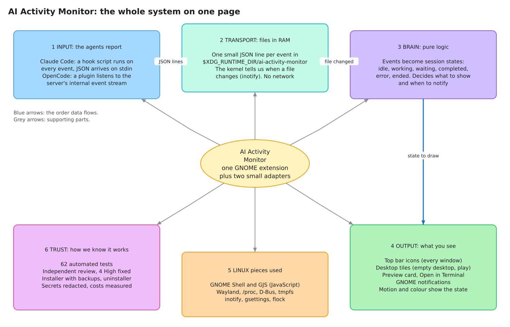
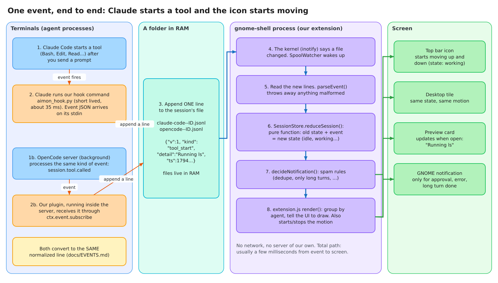
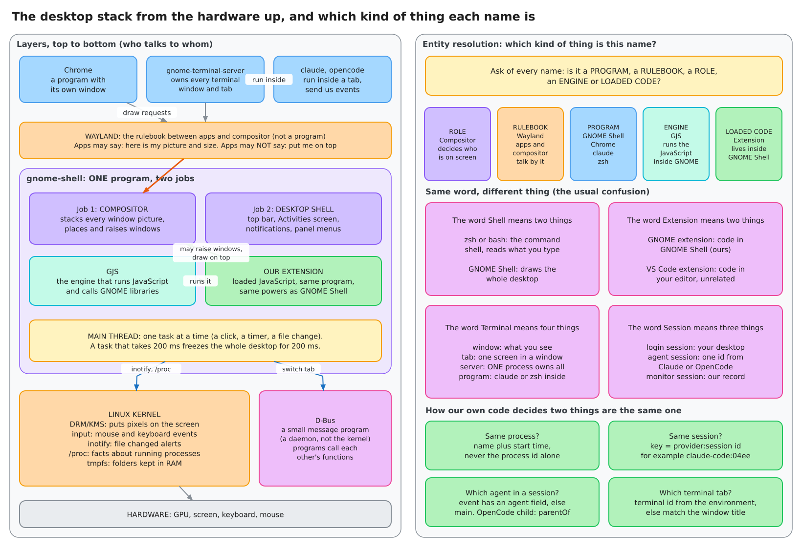

# GlanceAgent

A GNOME Shell 46 extension that shows what your Claude Code and OpenCode
sessions are doing, as small moving icons in the top bar and on the empty
desktop, so you can keep working in another window and still see which agent is
busy, waiting for you, or done.



## What it shows

* **Five states** per agent: idle, working, waiting for you (approval or
  input), completed, error. A coloured dot shows the state and a small number
  shows several sessions of one agent.
* **Top bar icons**, visible from every window. Hover for a short status, click
  for the preview, drag each icon anywhere along the bar. A "done" or "needs
  you" bubble appears when a result or a question arrives.
* **Desktop tiles** on the empty desktop. Unparked tiles roam, bounce off each
  other and say hi. Drag a tile to park it where you drop it; double click it
  (or use Release all in the preferences) to let it roam again. Tiles hide
  under application windows and while a fullscreen window covers the screen.
* **Motion that tells the state**: continuous up and down while working, a hop
  with a bounce while a result or question waits, still when idle. Reduced
  motion turns it off.
* **A preview card** on click: project, current step, recent activity, **Open
  in Terminal** (raises the session's terminal and switches to its tab) and
  **Dismiss**. It never takes keyboard focus from the window you are typing in.
* **Notifications without spam**: approval requests, errors, completed long
  turns and sessions that die unexpectedly, at most one per session.

## How it works

1. A Claude Code hook and an OpenCode plugin (the adapters) map agent events to
   one normalized event format.
2. Each event is appended as one JSON line to a spool file in
   `$XDG_RUNTIME_DIR/ai-activity-monitor/spool/` (RAM, never disk).
3. The extension watches that folder with inotify and replays the files after a
   restart.
4. A pure reducer (`lib/core`, no GNOME imports) turns events into session
   states.
5. A slow liveness sweep notices agents that died without saying goodbye.
6. The UI draws icons, the card and notifications from those states.



Why an extension and not an ordinary app: on Wayland only the compositor
(GNOME Shell) may draw on top of other windows, raise another program's window,
or watch clicks elsewhere.



## Requirements

* GNOME Shell 46 on Wayland. Developed on Ubuntu 24.04.
* `gjs` (part of GNOME) to run the extension.
* Python 3 for the Claude Code hook and the installer helper.
* Claude Code with hooks and/or OpenCode 2.x.
* Node.js, only to run the tests and the linter.

Nothing runs as root and no system packages are installed.

## Install

Every step is opt in and only touches the files listed.

```bash
scripts/install.sh --dry-run --all      # show what would change
scripts/install.sh --extension          # GNOME Shell extension
scripts/install.sh --claude             # Claude Code hooks
scripts/install.sh --opencode           # OpenCode plugin
```

| Step | Changes |
| --- | --- |
| `--extension` | Compiles the settings schema, copies the extension to `~/.local/share/gnome-shell/extensions/glanceagent@mehfooj.dev` (replacing any earlier copy) and appends it to the `org.gnome.shell enabled-extensions` setting. The previous value is saved in the extension folder. |
| `--claude` | Copies the hook to `~/.local/share/ai-activity-monitor/aimon_hook.py` and adds 11 hook entries to `~/.claude/settings.json`. A timestamped backup is written first, existing hooks are kept, and installing twice adds nothing. |
| `--opencode` | Copies the plugin to `~/.config/opencode/plugins/ai-activity-monitor.js`. |

Afterwards:

* Log out and back in once so GNOME Shell on Wayland loads the extension.
* Start new Claude Code sessions to report activity.
* Restart the OpenCode background server (`opencode serve --service`) to load
  the plugin.

## Uninstall

```bash
scripts/uninstall.sh --dry-run   # show what would be removed
scripts/uninstall.sh
```

This removes the extension and its settings, only the hook entries that contain
`aimon_hook.py` from `~/.claude/settings.json`, the hook copy, the OpenCode
plugin file and the spool folder. To roll the Claude settings back exactly, copy
back the newest `~/.claude/settings.json.aimon-backup-*` file. Log out and back
in to unload the extension from a running Wayland session.

## Settings

Open the preferences with `gnome-extensions prefs glanceagent@mehfooj.dev`,
or set keys directly:

```bash
gsettings --schemadir ~/.local/share/gnome-shell/extensions/glanceagent@mehfooj.dev/schemas \
  set org.gnome.shell.extensions.glanceagent completed-hold-seconds 60
```

| Key | Default | Meaning |
| --- | --- | --- |
| `panel-indicators` | true | Icons in the top bar |
| `desktop-tiles` | true | Tiles on the desktop |
| `panel-placement` | `{}` | Top bar slot of each icon, set by dragging |
| `desktop-play` | true | Roaming and greetings on the empty desktop (the most expensive feature, see the guide, Stage 4) |
| `show-on` | `desktop` | `desktop`: on the desktop layer of the current workspace, hidden where a window covers a tile. `always`: above every app |
| `hide-idle` | true | Hide sessions that are open but idle |
| `tile-positions` | `{}` | Dragged (parked) tile positions. Clear it, or use Release all, to let tiles roam again |
| `edge` | `left` | `left` or `right` screen edge for tiles that were never dragged |
| `offset-x`, `offset-y` | 12, 140 | Distance from the edge and from the top of the work area, in px |
| `icon-size`, `spacing` | 44, 10 | Desktop tile size and gap, in px |
| `animate-working` | true | Motion for working, done and needs you (does not control play mode) |
| `notify-completed`, `notify-approval`, `notify-error`, `notify-terminated` | true | Notification categories |
| `min-turn-seconds` | 15 | Only notify completion for turns at least this long |
| `completed-hold-seconds` | 180 | How long completed or error stays before returning to idle |
| `show-prompt-text` | true | Show prompt previews in the card |
| `terminal-command` | `gnome-terminal --working-directory=%d` | Used when no terminal exists for a session; `%d` is the session folder |

## Develop

```bash
npm test                         # 59 Node tests and 23 Python tests
npm run lint                     # ESLint
AIMON_HEADLESS=1 scripts/dev-nested.sh 1600x900   # headless test shell, own D-Bus session
scripts/devctl.sh state          # drive it: click <provider>, pointer click X Y, shot <png>
scripts/measure.py hook          # cost of one Claude hook run
scripts/measure.py shell         # CPU and memory with and without the extension
scripts/lab.sh watch             # print real agent events live
python3 docs/diagrams/build.py   # rebuild the diagrams
```

The test shell runs in its own D-Bus session with private settings, so it never
touches the real desktop. `lib/devcontrol.js` is enabled only when
`AIMON_DEV_CONTROL` is set, which only the harness does. See `AGENTS.md` for the
rules contributors and coding agents follow.

## Repository layout

```
extension/glanceagent@mehfooj.dev/   the GNOME Shell extension
  extension.js                           orchestrator: enable and disable
  prefs.js, schemas/, stylesheet.css     preferences, settings schema, styling
  lib/core/                              pure logic: model, store, policy, roaming
  lib/ui/                                tiles, top bar icons, preview card, motion
  lib/                                   spool watcher, notifier, windows, procs, providers
adapters/claude-code/                  hook script and hook template
adapters/opencode/                     OpenCode plugin
scripts/                               install, uninstall, dev shell, devctl, measure, lab
tests/                                 Node unit and contract tests, Python tests
docs/                                  ARCHITECTURE, DECISIONS, EVENTS, GUIDE
docs/diagrams/                         SVG and editable Excalidraw diagrams, build.py
```

## Documentation

* [docs/GUIDE.md](docs/GUIDE.md): the full guide, in four stages from the idea to
  the performance numbers, with diagrams and labs.
* [docs/ARCHITECTURE.md](docs/ARCHITECTURE.md): components, data flow and
  design reasons.
* [docs/DECISIONS.md](docs/DECISIONS.md): decision log, review findings, how it
  was verified, open risks.
* [docs/EVENTS.md](docs/EVENTS.md): the normalized event schema.

## Status and limits

* Developed and tested on Ubuntu 24.04, GNOME Shell 46 (Wayland), Claude Code
  2.1.x and OpenCode 2.3.x. Other setups are untested.
* GNOME only. The extension targets GNOME Shell 46 and will need changes for
  other versions.
* Open in Terminal switches tabs only in gnome-terminal.
* Indicators use the primary monitor only; multiple monitors are untested.
* OpenCode permission prompts were never observed live.
* An OpenCode subagent session is folded into its parent only if the plugin saw
  its creation, so a plugin loaded late can show it as a separate session.
* Play mode costs a few percent of one core while tiles roam; turn it off with
  `desktop-play` if that matters.
* The Claude and OpenCode logos belong to their owners; replace them if you
  redistribute this project.

## License

No license has been chosen yet; all rights reserved until one is added.
