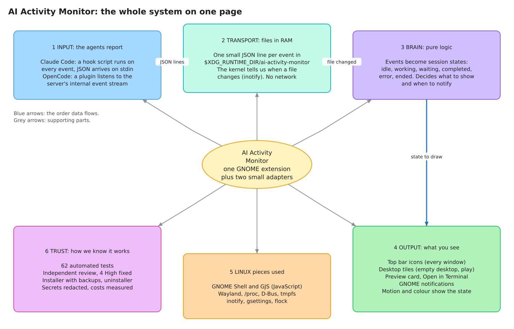
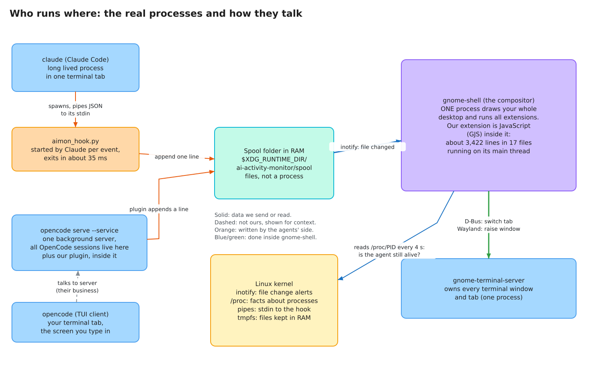
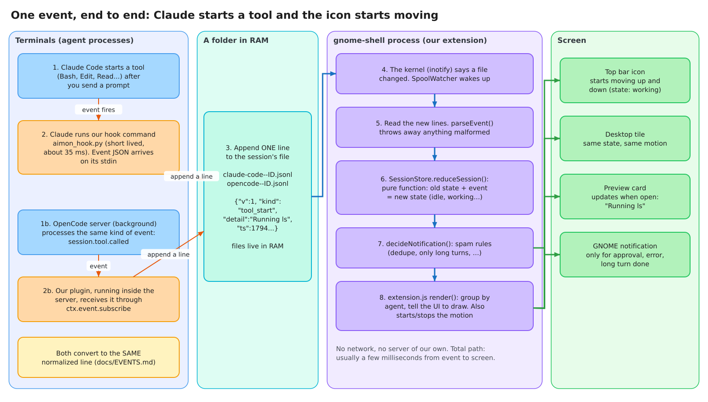
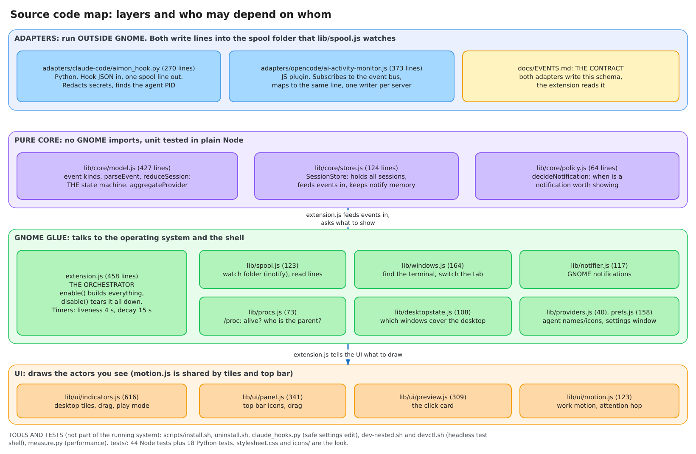
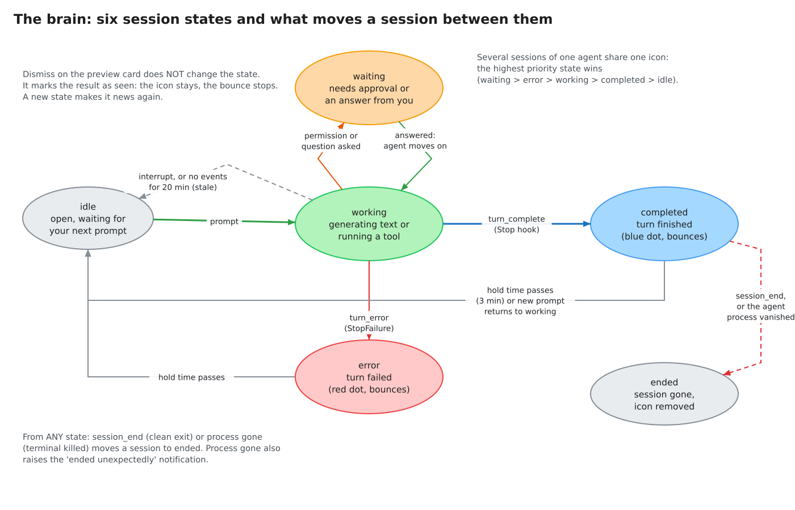
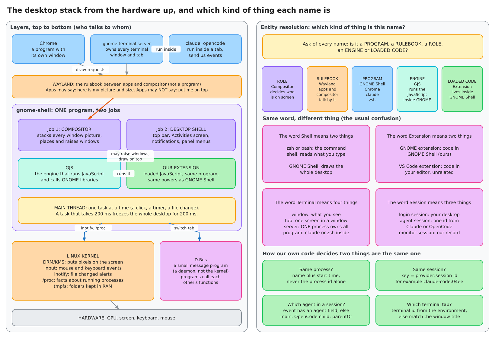
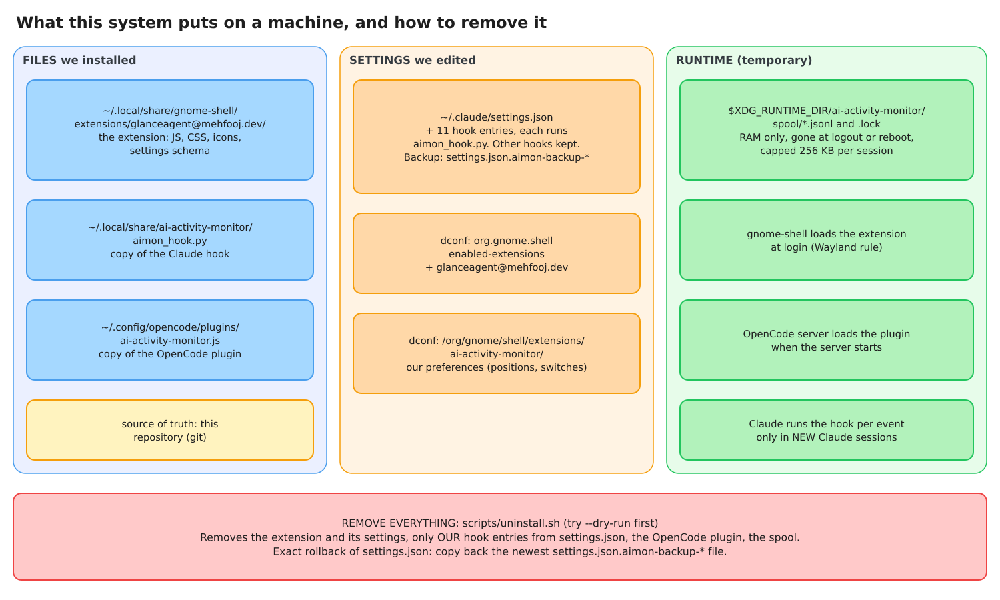
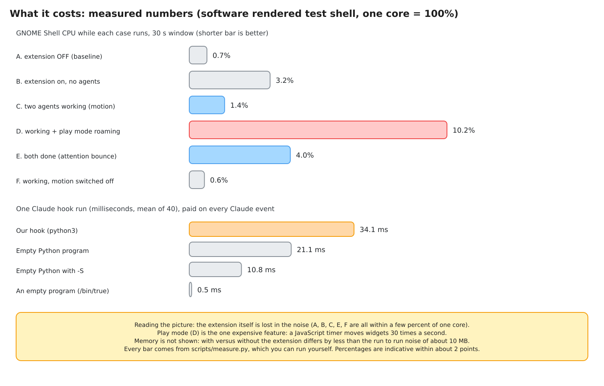

# Guide: how GlanceAgent works

This guide takes you from the idea to being able to explain, audit and change
every part of the running system. It is written from the real code in this
repository, so every claim can be checked. Where something was measured, the
guide says how. Where something was assumed or never verified, the guide says
that too.

Developed and tested on Ubuntu 24.04, GNOME Shell 46 (Wayland), Claude Code
2.1.x and OpenCode 2.3.x. Nothing here claims that other setups work.

## The four stages

| Stage | Question it answers | Read | Time |
| --- | --- | --- | --- |
| 1 | What is this thing and why is it shaped this way? | [Stage 1: The high level idea](#stage-1-the-high-level-idea) | 20 min |
| 2 | How does an agent event become a moving icon? How do we know how the agents work? | [Stage 2: System design and data flow](#stage-2-system-design-and-data-flow) | 40 min |
| 3 | What is in each file, and how does it talk to Linux? | [Stage 3: Architecture and source code](#stage-3-architecture-and-source-code) | 60 min |
| 4 | What does it cost a machine, and which numbers can be trusted? | [Stage 4: Performance and the system side](#stage-4-performance-and-the-system-side) | 30 min |
| Appendix | How can the main claims be audited in 15 minutes? | [Appendix: a 15 minute audit](#appendix-a-15-minute-audit) | 15 min |

The decision log, the independent review and the open risks are in
[DECISIONS.md](DECISIONS.md).

How to use each stage: read it, run its **Lab** (commands to paste into a
terminal from the repository root, all safe), then answer the **Check yourself**
questions without looking at the answers.

## The diagrams

Every diagram exists twice: an editable `.excalidraw` file (open it at
excalidraw.com, or in VS Code with the Excalidraw extension) and an `.svg`
picture that this guide embeds. They are generated from one script,
`docs/diagrams/build.py`, which reads real line counts from the source, so the
pictures cannot drift from the code. Rebuild with
`python3 docs/diagrams/build.py`.

| Diagram | Stage | Shows |
| --- | --- | --- |
| [01 mind map](diagrams/01-mind-map.svg) | 1 | The whole system on one page |
| [02 data flow](diagrams/02-data-flow.svg) | 2 | One event from agent to screen |
| [03 processes](diagrams/03-processes.svg) | 2 | Which programs run, and how they talk |
| [04 code architecture](diagrams/04-code-architecture.svg) | 3 | Layers of the source code |
| [05 state machine](diagrams/05-state-machine.svg) | 3 | The six states and their transitions |
| [08 desktop stack](diagrams/08-desktop-stack.svg) | 3 | Compositor, Wayland, GNOME Shell, GJS and the extension |
| [06 footprint](diagrams/06-footprint.svg) | 3 | Everything installed or edited on the machine |
| [07 performance](diagrams/07-performance.svg) | 4 | What costs what, measured or estimated |

## What do I call this?

People mix these words up, so here they are in one place. Our system is a
**GNOME Shell extension** (the part you see) **fed by two adapters** (a Claude
Code hook and an OpenCode plugin) **over a file based event pipeline**.

| Word | Meaning | Is that us? |
| --- | --- | --- |
| Desktop app | A program with its own window (GTK, Qt, Electron) | No |
| Daemon or service | A program that runs in the background by itself | No, we have none of our own |
| Extension | Code that runs inside another program and changes it | Yes: inside GNOME Shell |
| Hook | A command a program runs for you when something happens | Yes: Claude Code runs ours |
| Plugin | A code module a program loads for you | Yes: OpenCode loads ours |
| Adapter | A small translator between one agent and our format | Yes: the hook and the plugin |

## Vocabulary from first principles

Read this once now, come back whenever a term blocks you.

**Programs and processes**

* **Process**: a running program. Starting one costs time (the operating system
  must load it). `claude` is a process. A hook run is a short lived process.
* **Terminal**: a window that shows a text program. **Shell** is overloaded.
  The *command shell* (zsh, bash) is the program that reads what you type.
  *GNOME Shell* is the program that draws your whole desktop. Different things.
* **stdin, stdout**: every process has an input stream and an output stream.
  When Claude runs our hook it *pipes* a block of text into the hook's stdin.
* **Exit code**: a number a process returns when it ends. 0 means success.
  Our adapters always return 0 so they can never make an agent fail.

**Data formats and communication**

* **JSON**: a text format for structured data, like `{"kind":"tool_start"}`.
* **JSONL** (JSON lines): a file with one JSON object per line. Appending a
  line is cheap and safe, which is why we use it.
* **Event**: a message saying "this just happened" (a tool started).
* **IPC** (inter process communication): any way two processes exchange data.
  Ours is the simplest one: files.
* **API**: the set of functions a program lets you call. **SDK**: a code
  library that wraps an API. **JSON RPC**: a style of API where you send a JSON
  request and get a JSON reply. We use none of the three between our parts
  (see Stage 2 for what the agents expose instead).
* **Hook**: "run this command at this moment". **Plugin**: "load this code and
  call it at these moments".

**Linux pieces**

* **File descriptor**: a number a process uses to refer to an open file.
* **tmpfs**: a folder whose files live in RAM, not on disk. `$XDG_RUNTIME_DIR` (usually `/run/user/<uid>`) is
  one. Fast, and wiped at logout or reboot.
* **inotify**: the kernel tells a program "that file changed" so the program
  does not have to keep asking. This is what keeps us at near zero CPU.
* **flock**: a lock so two processes do not write the same file at once.
* **/proc**: a fake folder where the kernel shows facts about running
  processes (who is the parent, when did it start).
* **D-Bus**: a message bus programs use to call each other's functions on the
  desktop. We use it to ask the terminal to switch tabs.

**The desktop**

* **Compositor**: the program that decides what pixels appear on screen and
  where every window goes. On Wayland it is also the window manager.
* **Wayland**: the modern way apps talk to the compositor. By design an app
  cannot draw over other apps or raise another app's window. Only the
  compositor can. That single rule decided our architecture (Stage 1).
* **GNOME Shell**: the compositor and desktop shell of Ubuntu. **GJS**: GNOME's
  JavaScript engine. **Extension**: JavaScript loaded into GNOME Shell.
* **Main thread and event loop**: GNOME Shell runs its JavaScript on one thread
  that handles one task at a time. If our code takes too long, the whole
  desktop stutters. This is why "how much work per event" matters (Stage 4).
* **Signal and timer**: a signal is "tell me when X happens"; a timer is "call
  me every N seconds".

**Software design words**

* **State machine**: a thing that is always in exactly one state and moves
  between states when events happen. Our sessions are state machines.
* **Pure function**: same input always gives same output, touches nothing else.
  Pure code is easy to test. Our whole "brain" is pure on purpose.
* **Normalized event / contract**: all agents are translated to one shared
  format, written down in `docs/EVENTS.md`. The contract is what lets us add an
  agent without touching the brain.
* **Race condition**: a bug that only appears when two things happen at nearly
  the same time (two hooks writing one file).
* **Replay**: rebuilding current state by re running the saved events. We do it
  after a desktop restart.

## Reading order for the real code

1. `docs/EVENTS.md` (the contract, about 50 lines)
2. `extension/glanceagent@mehfooj.dev/lib/core/model.js` (the brain)
3. `tests/unit/model.test.js` (the brain's specification, as examples)
4. `adapters/claude-code/aimon_hook.py` then `adapters/opencode/ai-activity-monitor.js`
5. `extension/glanceagent@mehfooj.dev/lib/spool.js`, then `extension.js`
6. The `lib/ui/` files last, because they are the most GNOME specific

Stage 3 explains this order.


---

# Stage 1: The high level idea

## The problem

You run coding agents (Claude Code, OpenCode) in terminal windows. While one
works you want to use another window, and you want to know at a glance: is it
still working, does it need my approval, did it finish, did it fail? Without
this you keep switching to the terminal just to look.

## The idea in one paragraph

Make the agents *tell the desktop* what they are doing, then draw that as small
icons that move and change colour. The agent does not know about icons, the
icons do not know about agents. A thin translator on each side keeps them apart.



Read the mind map clockwise: (1) the agents report, (2) the reports are written
as lines into files in RAM, (3) a pure logic layer turns lines into session
states, (4) the desktop draws icons, cards and notifications. Boxes 5 and 6 are
what everything stands on: Linux features, and the tests and safety rails.

## Why a GNOME Shell extension and not an app?

This was the single most important decision, and it came from one fact about
the target desktop, not from taste. Ubuntu 24.04 runs **Wayland** by default.
On Wayland an ordinary program is not allowed to:

* draw a window on top of other programs' windows,
* choose where its window appears,
* raise another program's window to the front,
* watch your clicks in other programs.

Our requirements need all four (icons floating over everything, draggable
anywhere, "Open in Terminal" raising a window, closing the card when you click
elsewhere). Only one program is allowed to do those things: the **compositor**,
which on Ubuntu is GNOME Shell. And GNOME Shell lets you add code to it, called
an extension. So the extension is not a style choice, it is the only door.

| Option | Why not |
| --- | --- |
| Own GTK or Qt window | Wayland will not keep it on top or place it where we want |
| Electron app | Same Wayland limits, plus 150 MB or more of RAM for a browser engine |
| System tray icon (AppIndicator) | One tiny static icon in the corner: no animation, no drag, no card |
| Polling `ps` to guess activity | Cannot tell "idle" from "working"; wastes CPU |
| **GNOME Shell extension** | Full control of the screen; the cost is being tied to GNOME |

The requirements fixed what to draw, so the only open question was which
technology is allowed to draw it. The table above is the answer.

## Project history

How the project was built, in order, with the lesson of each step.

| Step | What happened | Lesson |
| --- | --- | --- |
| 1. Brief | A written specification (states, animation, click rules, notifications), mockups of the target look, and working rules (verify with real tests, ask before system changes) | The mockups say what it should look like, not how to build it |
| 2. Discovery | The development machine was inspected before anything was chosen: Ubuntu 24.04, GNOME Shell 46, Wayland, gjs 1.80, Python 3.12, Node 24, Claude Code 2.1.x, OpenCode 2.3.x, one terminal (`gnome-terminal`) | Inspect the real environment first, assumptions cost the most later |
| 3. Matching the real look | The first test window showed the stock theme instead of the target desktop theme, so the harness now mirrors theme, wallpaper and fonts from the host session, read only | Test against the real look, or you test the wrong thing |
| 4. Parallel research | GNOME 46 APIs were verified from the installed source and a real nested shell run. Real Claude Code and OpenCode sessions ran with logging to learn the event shapes. Icons, the settings schema and preferences were made alongside | Research is cheap and independent; verifying beats remembering |
| 5. Design | Extension for display, adapters per agent, files in RAM as the message path, a pure logic core (Stage 2 explains each) | Decide the boundaries first; the boundaries are the architecture |
| 6. Build the brain first | `model.js`, `store.js` and `policy.js` with unit tests before any pixel was drawn | Build the part with no UI first: fast to test, hard to break later |
| 7. Adapters, then extension, then UI | In that order, each tested before the next | Each layer is proven before it is depended on |
| 8. Real agents, real shell | A headless GNOME Shell (invisible, own settings) ran against live Claude Code and OpenCode sessions. Eight bugs were found and fixed | Unit tests prove logic, only real use proves the product |
| 9. Independent review | A reviewer with no stake found four High issues, for example a race that lost 40% of events under stress | A reviewer with no stake finds what the author cannot |
| 10. First real use | Feedback after installing: icons over every app, no dragging, dead buttons, wrong icons, top bar, play mode. Each became a fix plus a test | The first real use always finds what the test shell cannot |
| 11. Refinement | Roaming rules moved into a pure file (`lib/core/roaming.js`) with tests, tiles can be parked by dragging, the attention motion became urgent, the top bar gained a "done" or "needs you" bubble | Pull rules out of GNOME code so they can be tested |

Honest notes on where it went wrong, because they teach more than where it went
right: an early test run left a stray helper process drawing on a real screen
(the harness now unsets `DISPLAY`); a card rebuilt itself on every event and
swallowed clicks; a hidden dummy menu on the top bar icons stole drag events.
Each was found by testing with real input, none by reading code.

## What is reusable and what is tied to the tested setup

It is not a general product yet. This table is the honest boundary.

| Part | Reusable? | Why |
| --- | --- | --- |
| Event contract (`docs/EVENTS.md`) | Yes, anywhere | Plain data format |
| Brain (`lib/core/*.js`) | Yes, any JavaScript | Pure code, runs in Node, no GNOME |
| Adapters | Mostly | The hook uses `/proc` to find the agent (Linux only); the plugin is plain JS |
| Spool folder on tmpfs | Linux and similar | Uses `XDG_RUNTIME_DIR` |
| All display code (`lib/ui/*`, notifier, windows, desktopstate, extension.js) | No | Written for GNOME Shell 46, its APIs change between versions |
| Tab switching in a terminal | Only gnome-terminal | Uses its D-Bus action `active-tab` |
| Finding the right tab | Only the tested setup | Matches Claude's title glyph and the `OC |` prefix OpenCode puts in tab titles |
| Installation | The current user's home folder | Edits `~/.claude/settings.json` and the OpenCode plugins folder |

If you ever wanted another desktop (KDE) or macOS, you would keep the contract,
the brain and most of the adapters, and rewrite only the display layer. That is
exactly why the layers are separate.

## The three rules that shaped everything

1. **React to events, do not poll.** The agents tell us when something happens.
   The only timers are slow safety checks (is the agent still alive, every 4 s).
2. **Keep the brain pure.** Logic that does not touch the desktop can be tested
   in a second without a desktop. That is how 91 tests (60 Node, 31 Python) run in seconds.
3. **Never break the agent or the desktop.** The hook always exits 0 and prints
   nothing. The extension catches its own errors. If we fail, you lose an icon,
   not your work.

## Lab: look at the real thing

Run these from the repository root.

```bash
# 1. What is installed, and is the extension loaded?
gnome-extensions info glanceagent@mehfooj.dev | head -5

# 2. See the real agent processes
ps -o pid,ppid,etime,comm -C claude,opencode

# 3. See the folder where events land, and what is in it
ls -la "$XDG_RUNTIME_DIR/ai-activity-monitor/spool/"

# 4. Read the contract. If you understand this file you understand the system.
sed -n 1,52p docs/EVENTS.md
```

## Check yourself

1. Why could we not build this as a normal window app on GNOME with Wayland?
2. What is the difference between a hook and a plugin?
3. Why was the brain built and tested before any icon was drawn?
4. Name two parts that would survive a move to KDE, and two that would not.
5. Which of the three rules explains why the hook prints nothing and exits 0?

**Answers**

1. Wayland forbids ordinary programs from staying on top, choosing their
   position, raising other windows and watching clicks elsewhere. Only the
   compositor (GNOME Shell) may.
2. A hook is a command the agent runs for us per event (Claude Code). A plugin
   is code the agent loads and calls (OpenCode). Same purpose, different
   mechanism.
3. Pure logic needs no desktop to test, so it can be proven correct fast, and
   everything built on it can trust it.
4. Survive: the event contract and the brain. Do not survive: the GNOME display
   code and the gnome-terminal tab switching.
5. Rule 3: never break the agent. Output or a failure exit could change how the
   agent behaves.


---

# Stage 2: System design and data flow

Goal: by the end you can draw, from memory, how one agent event becomes a moving
icon, and you know *how we found out* how Claude Code and OpenCode expose their
activity.

## Part A: How can an outsider watch a coding agent?

An agent is just a program. It will only tell outsiders what it was built to
tell them. There are three possible ways in, and the agents offer different
ones.

| Way in | How it works | Who offers it | We use it? |
| --- | --- | --- | --- |
| **Hook** | You register a command. The agent runs it at fixed moments and pipes details to its stdin | Claude Code | Yes, main input |
| **Plugin** | You drop a code file in a folder. The agent loads it and sends it events | OpenCode 2.x | Yes, main input |
| **Watch the outside** | Look at processes, files or logs the agent produces | Anything | Only as a safety check |

### A1. Claude Code hooks

You tell Claude Code, in `~/.claude/settings.json`, "when event X happens, run
this command". The command receives one JSON object on **stdin** describing the
event. The installer adds 11 entries; this is the shape of one (for the tool
events):

```json
"PreToolUse": [
  { "matcher": "*",
    "hooks": [ { "type": "command",
                 "command": "python3 <home>/.local/share/ai-activity-monitor/aimon_hook.py",
                 "timeout": 5 } ] }
]
```

`<home>` stands for the absolute path of the home folder. The installer writes
it expanded and shell quoted.

What arrives on stdin for a tool start (real shape, shortened):

```json
{"session_id":"04ee3441-...","cwd":"/path/to/project","hook_event_name":"PreToolUse",
 "tool_name":"Bash","tool_input":{"command":"sleep 25 && echo done"},"tool_use_id":"toolu_..."}
```

The 11 events we listen to and what each tells us:

| Hook event | Meaning for us |
| --- | --- |
| `SessionStart` | A session exists, so show it as idle. Also gives us the agent's process id |
| `UserPromptSubmit` | You sent a prompt: working |
| `PreToolUse` / `PostToolUse` | A tool began / ended (Bash, Edit, Read...): working, with a description |
| `PostToolUseFailure` | A tool failed (or you interrupted) |
| `PermissionRequest` | The agent is blocked asking you: waiting |
| `Notification` | Several kinds; we use `idle_prompt` (idle for a minute) and permission style ones |
| `Stop` | The turn finished: completed |
| `StopFailure` | The turn failed, with a reason such as `model_not_found`: error |
| `PreCompact` | The agent is compacting its memory: still working |
| `SessionEnd` | The session closed cleanly: ended |

Facts about hooks that shaped the design:

* **A hook is a new process every time.** The agent starts our script, waits for
  it to finish (we set a 5 second limit), then continues. So a hook must be fast
  and must never fail. Ours exits 0 always and prints nothing, because the
  agent can treat hook output as instructions and a non zero exit can block a
  tool.
* **The process tree is hook, `sh -c`, `claude`.** We verified this by running
  a real session with a logging hook. It means the *grandparent* of the hook is
  the long lived `claude` process, so we can record its process id and later
  ask the kernel "is that process still alive?".
* **Subagents share the session id.** A subagent's events carry an extra
  `agent_id`. Without it a subagent finishing would look like the main agent
  finishing. We drop subagent `Stop` events and pass `agent_id` on as the
  `agent` field.
* **There is no "permission granted" event.** We infer "approved" from the next
  tool event for that agent.

### A2. OpenCode plugins (2.x)

OpenCode 2.x is two things: one background **server** (`opencode serve
--service`) that holds all sessions, and **clients** (the terminal screens you
type in). A plugin is a JavaScript file the server loads. Its shape:

```js
export default {
  id: 'ai-activity-monitor',
  async setup(ctx) {                       // called once when the server loads it
    for await (const event of ctx.event.subscribe({signal})) { ... }   // the live event stream
    return () => { /* cleanup when unloaded */ };
  },
};
```

A real event (shortened) and what we make of it:

```json
{"type":"session.tool.called",
 "data":{"sessionID":"ses_e308...","id":"call-964a...","input":{"command":"npm test"}},
 "location":{"directory":"/path/to/project"}}
```

becomes a `tool_start` line with detail `Running npm test`. The tool's *name*
arrives in an earlier event, `session.tool.input.started`, so the plugin
remembers it by call id.

Facts that shaped the design:

* **The plugin runs inside the server, not in your terminal.** Its process id
  and environment variables belong to the server. So the plugin cannot know
  which terminal a session belongs to. We solve "is this session still open?"
  differently (see Stage 3: a client process must be sitting in the session's
  folder).
* **One plugin copy is loaded per project folder, and each sees every event.**
  Without protection we would write each event several times. A small registry
  keeps exactly one active subscriber and hands over if it is unloaded.
* **Subagents are separate sessions** with a `parentID`; we fold them into
  their root session so the icon shows one agent.

### A3. The alternatives we did not take

| Alternative | Why not |
| --- | --- |
| Tail Claude's transcript files in `~/.claude/projects/` | Not an official interface (format may change), contains full conversations (privacy), awkward to map to "waiting for approval" |
| Call OpenCode's own HTTP server from outside | Needs its credentials and a client library, more moving parts than a plugin inside the server |
| Poll `ps` to see if the agent is busy | A process looks identical whether it waits for you or works. Cannot be done |
| Screen scraping the terminal | Fragile, privacy invasive, breaks with themes |

## Part B: How we found out ("reverse engineering")

Nothing here was decompiled or hacked. Every fact came from **observing the real
programs on the development machine**, backed by their documentation. This table is the
method you can repeat for any other agent.

| We needed to know | Method | Result | How sure |
| --- | --- | --- | --- |
| Which hook events exist and their fields | Read the official hooks documentation | 30+ events, field lists | Documented |
| What the payloads really look like | Ran `claude -p "..."` with a logging hook, in a scratch folder, then read the log | Real JSON for SessionStart, UserPromptSubmit, PreToolUse, PostToolUse, PermissionRequest, Stop, SessionEnd | Observed |
| Which process is the long lived `claude` | Logged the parent chain inside the hook | hook, `sh -c`, `claude` | Observed |
| What a failed turn looks like | Asked for a model that does not exist, logged the `StopFailure` payload | `"error": "model_not_found"` | Observed |
| OpenCode plugin API | The first guess (from installed type definitions, package version 1.18) was **wrong**: version 2.3 has a different shape. We then wrote a probe plugin that logs everything | `{id, setup(ctx)}`, event stream in `ctx.event` | Observed |
| OpenCode event names and fields | Probe plugin plus an existing debug log of real sessions | session.execution.started, session.tool.called ... | Observed |
| OpenCode permission and question events | Searched the program's binary for event name strings | `permission.asked`, `question.asked` exist | **Not observed live** |
| That the plugin runs in a shared server | Found our test events written by the server's process id, not by the terminal's | Shared server | Observed |

Lessons: the installed type definitions lied (they were for an older API);
the most valuable tool was a throwaway *probe* that logs everything; and the
last row is the honest gap: if OpenCode's approval prompts misbehave, that is
where to look first.

## Part C: The design and why

Five components, five decisions.



| Decision | Chosen | Alternatives | Why |
| --- | --- | --- | --- |
| Where to draw | GNOME Shell extension | App, Electron, tray icon | Wayland (Stage 1) |
| How adapters talk to the extension | Append lines to files in RAM | D Bus calls, a socket, HTTP, shared memory | See below |
| Where state lives | In the extension's memory, rebuilt from the files | A database, a daemon | Simplest thing that survives a desktop restart |
| How to know an agent died | Check the process in `/proc` every 4 s | Trust `SessionEnd` only | A closed terminal sends no `SessionEnd` |
| Hook language | Python, standard library only | Shell, Node | Fast enough (about 35 ms), readable, safe string handling |

**Why files in RAM carry the messages.** The adapters and the extension are
different programs started by different parents at different times. Files
decouple them completely:

* The adapter works even if the desktop extension is not running.
* After a desktop restart the extension *replays* the files and is correct again.
* You can debug with `cat` and `tail`; there is nothing hidden.
* No extra background program to run, secure or restart.
* Writes are tiny appends, and the folder is RAM (tmpfs), so nothing touches
  the disk.

Costs: a few milliseconds of latency, files need size limits (256 KB per session,
older lines trimmed) and cleanup, and two writers need a lock.

## Part D: The contract

Both adapters write the same line, one JSON object per line:

```json
{"v":1,"ts":1794572136.78,"provider":"claude-code","session":"04ee3441-...",
 "kind":"tool_start","tool":"Bash","detail":"Running sleep 25 && echo done",
 "cwd":"/path/to/project","pid":92552}
```

`kind` is one of 14 values (`session_start`, `prompt`, `activity`, `tool_start`,
`tool_end`, `tool_error`, `permission`, `permission_resolved`, `input_needed`,
`turn_complete`, `turn_error`, `turn_interrupted`, `idle_hint`, `session_end`).
The full table, with which hook and which OpenCode event produce each one, is
`docs/EVENTS.md`. Adding a third agent means writing a new adapter that emits
these lines, one entry in `lib/providers.js` and an icon. Nothing else changes.
That is the point of a contract.

## Part E: Follow one event



Claude starts the Bash tool. In code, in order:

1. Claude spawns `python3 aimon_hook.py` and writes the JSON to its stdin.
2. `main()` reads stdin, `build_event()` maps `PreToolUse` to `tool_start`,
   `describe_tool()` makes the text "Running ...", `redact()` removes secrets,
   `find_agent_pid()` walks the parents.
3. `append_line()` takes a lock file and appends the line to
   `claude-code--<session>.jsonl`. The process exits (about 35 ms in total).
4. The kernel sees the file change and tells the extension (inotify).
   `SpoolWatcher` waits 40 ms (to batch bursts), then reads only the new bytes.
5. `parseEvent()` validates every line and rejects anything odd.
6. `SessionStore.ingestLine()` calls `reduceSession(old, event)` which returns
   the new session record, and `decideNotification()` decides whether to notify.
7. `extension.js` `_render()` groups sessions per agent and calls the UI.
8. The tile and the top bar icon call `Motion.set('work')`: the icon starts
   moving. The preview card, if open, updates its text.

## Part F: What can go wrong, and the answer built in

| Problem | Why it happens | Built in answer |
| --- | --- | --- |
| Two hooks write one file at once | Claude runs hooks in parallel | A separate lock file around every write (found in review, see [DECISIONS.md](DECISIONS.md)) |
| A late event arrives after the turn ended | Parallel processes finish out of order | Events older than the last turn boundary are ignored |
| The end of a turn is never reported | A crash, an interrupt | Working for 20 minutes without any event becomes idle |
| The terminal is closed hard | No `SessionEnd` can run | Process identity (name plus start time) checked every 4 s, then "ended unexpectedly" |
| The desktop restarts | The extension's memory is lost | Replay the files, silently (no duplicate notifications), re post pending approvals |
| Several sessions of one agent | Normal use | One icon, highest priority state wins, a count badge, a switcher in the card |
| A subagent finishes | Shares the session id | Its `Stop` is dropped and pending prompts are tracked per agent, so it neither completes the parent nor clears its approval (see Stage 3) |
| Secrets in commands | Commands are shown in the card | Redaction patterns, first line only, home path shortened |
| Notification spam | Every state change | One notification per session, deduplicated, completion only for turns of 15 s or more |

## Lab

```bash
# 1. Turn a raw Claude event into our line, in a throwaway folder
export AIMON_SPOOL_DIR=$(mktemp -d)
echo '{"session_id":"lab1","cwd":"/tmp","hook_event_name":"PreToolUse","tool_name":"Bash","tool_input":{"command":"ls -la"}}' \
  | python3 adapters/claude-code/aimon_hook.py
cat $AIMON_SPOOL_DIR/*.jsonl            # that is the normalized event
unset AIMON_SPOOL_DIR

# 2. Watch REAL events live. Start it, then use Claude or OpenCode elsewhere.
scripts/lab.sh watch

# 3. Make an icon appear without any agent, then remove it
scripts/lab.sh fake working     # a tile named "lab" appears, moving
scripts/lab.sh fake waiting     # it turns amber and one notification appears
scripts/lab.sh fake done        # it turns blue and bounces
scripts/lab.sh clean            # it disappears

# 4. See the hooks that are registered, and the process tree
python3 scripts/claude_hooks.py status ~/.claude/settings.json
ps -eo pid,ppid,etime,args | grep -E "[c]laude|[o]pencode" | cut -c1-110
```

## Check yourself

1. Why does the Claude hook print nothing and always exit 0?
2. How do we know which process is the real `claude`?
3. Why can the OpenCode plugin not tell which terminal a session is in?
4. Give two reasons files in RAM are a good message path here, and one cost.
5. A session shows "working" forever after the user pressed Esc. Which two
   mechanisms limit that?

**Answers**

1. Hook output can be read by the agent as instructions and a failing exit can
   block a tool. We must never change agent behaviour.
2. The hook's parent is `sh -c` and its grandparent is `claude`. We verified the
   chain with a logging hook and record that process id.
3. The plugin lives in the shared server process, whose id and environment are
   the server's, not the terminal's.
4. Decoupled programs, replay after restart, debuggable with `cat`, no new
   daemon. Cost: needs size limits, cleanup and locking, plus a few ms latency.
5. The `turn_interrupted` event when the agent reports it, and the stale working
   timeout (20 minutes without events returns the session to idle). The
   `idle_prompt` notification also corrects it after about a minute.


---

# Stage 3: Architecture and source code

Goal: you can open any file in this repository and say what it is for, what it
calls, what calls it, and which test protects it. You also understand the Linux
features the code relies on.



## The one rule that organizes the code

Code is split into four layers and dependencies only point **downwards towards
the pure core**:

| Layer | Files | May import GNOME? | How it is tested |
| --- | --- | --- | --- |
| Adapters | `adapters/*` | No | Unit and contract tests, plus real agent runs |
| Pure core | `lib/core/*.js` | **No, never** | Fast unit tests in plain Node |
| GNOME glue | `extension.js`, `lib/spool.js`, `procs.js`, `windows.js`, `desktopstate.js`, `notifier.js`, `providers.js`, `prefs.js` | Yes | Live test shell only |
| UI | `lib/ui/*.js`, `stylesheet.css` | Yes | Live test shell only |

The rule "the core never imports GNOME" is the most valuable line in
`AGENTS.md`. It is why the brain can be proven correct in a second, and why the
brain could move to another desktop untouched.

## Reading order, and why

1. **`docs/EVENTS.md`**: the contract. Everything else is "produce these lines"
   or "consume these lines".
2. **`lib/core/model.js`**: the state machine. This is the product's logic.
3. **`tests/unit/model.test.js`**: the same logic as worked examples.
4. **`lib/core/store.js`, `lib/core/policy.js`**: holders and rules around it.
5. **The two adapters**: how raw agent events become contract lines.
6. **`lib/spool.js`, then `extension.js`**: how lines get into the brain and how
   results get out.
7. **`lib/ui/*`**: last, because it is the most GNOME specific and the most
   fiddly.

## File by file

Line counts are as of writing. Names in `backticks` are functions you can
search for.

### Adapters

| File | Lines | What it does | Key functions |
| --- | --- | --- | --- |
| `adapters/claude-code/aimon_hook.py` | 270 | Runs once per Claude event. Reads JSON on stdin, writes one contract line | `map_event` (which hook becomes which kind), `describe_tool` (the "Running ls" text), `redact` (secrets), `find_agent_pid` (walks `/proc`), `append_line` (lock, append, trim), `main` (never fails) |
| `adapters/opencode/ai-activity-monitor.js` | 373 | Loaded by the OpenCode server. Subscribes to events, writes the same lines | `mapEvent` (pure: event to lines), `createTracker` (remembers tool names, subagent parents, directories), `createWriter` (file append), `createRegistry` (one active subscriber per server) |

Things to notice: both adapters share the redaction rules (the test vectors live
in `tests/redaction_vectors.json` and both test suites read them), and both are
written so that an error is swallowed, never surfaced to the agent.

### Pure core

| File | Lines | What it does |
| --- | --- | --- |
| `lib/core/model.js` | 427 | Defines the 14 event kinds and 6 states. `parseEvent` validates a raw object. `reduceSession(old, event)` returns the new session record (the state machine). `decaySession` returns idle after a hold time or a stale period. `aggregateProvider` merges several sessions into the one state an icon shows |
| `lib/core/store.js` | 124 | `SessionStore`: a map of all sessions. `ingestLine` parses and applies a line and returns what changed. `markProcessGone`, `end`, `acknowledge`, `decayAll`, `byProvider` |
| `lib/core/policy.js` | 64 | `decideNotification(prev, next, context)`: given a transition, answer "notify, and how urgent?" or nothing |
| `lib/core/roaming.js` | 20 | `isParked`, `roamers`, `release`: which desktop tiles are parked (dragged to a saved position) and which may roam. Pure, so the rule is unit tested |

`reduceSession` is a **pure function**: it never changes its input, never reads
the clock, never touches the desktop. Same input, same output, which is what
makes it testable. A real test, simplified:

```js
run(store, [ev('session_start'), ev('prompt'), ev('tool_start'), ev('permission')]);
assert.equal(store.get('claude-code:s1').state, 'waiting');
run(store, [ev('tool_end')]);
assert.equal(store.get('claude-code:s1').state, 'working');
```



Three details in the reducer that matter most:

* **Turn boundary.** When a turn completes, the timestamp is stored. Any event
  older than it is a late straggler from a parallel process and is dropped.
* **Pending prompts per agent.** `session.pending` remembers which agent (main
  or a subagent) is blocked. A tool event from another agent cannot clear it.
* **Acknowledged flag.** Dismiss only sets a flag. The state stays so the icon
  stays, but the bounce stops. Any new state clears the flag.

### GNOME glue

| File | Lines | What it does | Linux or desktop feature used |
| --- | --- | --- | --- |
| `extension.js` | 458 | The orchestrator. `enable()` builds everything, `disable()` releases every timer, signal and actor. Owns the two timers: `_checkLiveness` every 4 s, `decayAll` every 15 s | GLib timers, gsettings |
| `lib/spool.js` | 123 | `SpoolWatcher`: replays existing files at start (silently), then watches the folder. Reads only the new bytes since the last offset, detects trimming (file got smaller) | inotify via `Gio.FileMonitor` |
| `lib/procs.js` | 73 | `processIdentity` (name plus start time of a process), `ancestors`, `listProcesses` | `/proc/PID/stat`, `/proc/PID/cwd` |
| `lib/windows.js` | 164 | `focusTerminal`: find the right terminal window and switch to the right tab. `openTerminal`: fallback | D Bus action `active-tab`, `Main.activateWindow`, `Shell.util_spawn_async` |
| `lib/desktopstate.js` | 108 | Which application windows cover which part of the desktop, for "tiles live on the desktop" and play mode | Meta window signals |
| `lib/notifier.js` | 117 | One notification per session, replaced in place | GNOME `MessageTray` |
| `lib/providers.js` | 40 | Per agent facts: name, icon, tab title rules, how to tell a client is attached | none |
| `prefs.js` | 148 | The preferences window | libadwaita, gsettings |
| `lib/devcontrol.js` | 157 | Test only: lets the headless test shell be driven. Active only if an environment variable points into the test folder | none |

### UI

| File | Lines | What it does |
| --- | --- | --- |
| `lib/ui/indicators.js` | 616 | The desktop tiles: one actor per agent, hover label, drag with a pointer grab. A dragged tile is parked at its saved position and stops roaming; a double click frees it. Play mode moves the unparked tiles, which collide with each other and with parked tiles, with speech bubbles |
| `lib/ui/panel.js` | 341 | The top bar icons: placed anywhere in the left, centre or right section, drag to move, saved slots, and a "done" or "needs you" bubble when a result or question arrives |
| `lib/ui/preview.js` | 309 | The click card (380 px wide), built once and updated in place, with a click catcher underneath so any outside click closes it |
| `lib/ui/motion.js` | 123 | Shared motion: `work` (continuous up and down), `attention` (four hops with a bounce and a 120 ms rest between them, then still until the next attention), `none` |

Why the card is "built once, updated in place": rebuilding the whole card on
every event destroys the buttons, so a click that lands between press and
release hits a button that no longer exists. Lesson: UI that other code changes
under the cursor must keep its widgets alive.

## The desktop stack

Before the Linux details, one picture of who is who on the desktop. The same
words mean different things (shell, extension, terminal, session), so the right
half of the diagram sorts every name into program, rulebook, role, engine or
loaded code. Our extension is JavaScript that GJS runs inside the GNOME Shell
process, on its main thread, with the compositor's powers.



## Subagents, pending prompts and the idle hint

**A subagent finishing must not complete its parent.** Both agents run
subagents inside the parent's session. Claude Code subagent hooks share the
parent's session id and add an `agent_id`. OpenCode runs each subagent as a
child session with a `parentID`. Without care, a subagent's end of turn would
look like the main turn finishing and the icon would turn blue too early.

* **Claude hook** (`map_event` in `aimon_hook.py`): a `Stop` event with an
  `agent_id` returns nothing, so it is dropped. Other subagent events carry the
  id as the `agent` field (cut to 64 characters).
* **OpenCode adapter** (`mapEvent`): on `session.created` with a `parentID` it
  records the link in `tracker.parentOf` and emits nothing. Later events of the
  child are reported on the root session with `agent` set to the child's id.
  A child's prompt, completion and interrupt events are dropped. The link is
  only known if the plugin saw the creation event (see the "joined late" limit
  in [DECISIONS.md](DECISIONS.md)).

**Pending is tracked per agent.** `session.pending` in `model.js` is a map from
agent (`main` when the event has none) to the prompt it is blocked on. A
`permission` or `input_needed` event sets `pending[agent]`. A later tool,
activity or `permission_resolved` event from the same agent resolves only that
entry (`resolvePending`), and the session leaves `waiting` only when no agent is
still blocked. Example: the main agent runs subagents A and B, A asks for an
approval and B keeps running tools. B's events never touch `pending[A]`, so the
icon stays amber and the notification stays until A itself moves on. A turn
boundary (`turn_complete`, `turn_interrupted`, `idle_hint`) clears all pending
entries.

**The idle hint.** Claude Code sends a `Notification` with type `idle_prompt`
after the session has been idle at the prompt for about a minute. The hook maps
it to `idle_hint`. In the reducer it moves a `working` session to `idle`, sets
the turn boundary and clears the turn state. It never overrides `waiting` (an
open approval is still open) and never overrides `completed`. It is a backstop
for a missed end of turn, for example an interrupt that fired no hook. OpenCode
has no equivalent, so it relies on its interrupt events and on the 20 minute
stale working timeout.

## The lifecycle of the extension

GNOME loads extension code at login (a Wayland rule) and calls `enable()`:

1. Open settings, create the `SessionStore`.
2. Create the notifier, the tiles, the card, the desktop watcher, the top bar.
3. Start the spool watcher: it **replays** existing files silently.
4. Run one liveness check, re post still pending approvals, draw.
5. Start two timers: liveness (4 s), decay (15 s).

`disable()` (screen lock, logout, you turning it off) must undo every one of
those. A leaked timer or actor is the classic extension bug, so there is a rule
for it in `AGENTS.md`.

## The Linux side, concretely

| Feature | Where | Why it matters |
| --- | --- | --- |
| **tmpfs** (`$XDG_RUNTIME_DIR`) | Spool folder | Files in RAM: fast, no disk wear, gone at logout |
| **inotify** | `lib/spool.js` | The kernel wakes us when a file changes: no polling loop, near zero idle cost |
| **flock** | `append_line` in the hook | Two hooks cannot interleave their writes. The lock lives on a separate `.lock` file, because trimming replaces the data file and a lock on a replaced file protects nothing |
| **`/proc/PID/stat`** | `procs.js`, the hook | Name and start time of a process. Name plus start time is the identity, so a recycled process number cannot fool us |
| **`/proc/PID/cwd`** | `listProcesses` | OpenCode sessions live in a shared server, so "is a client open in this folder" decides if a session is still attached |
| **D Bus** | `lib/windows.js` | GNOME Terminal exposes `active-tab` as a remote action. We set it while watching the window title change, and keep the tab whose title matches the agent |
| **Wayland** | everywhere in the UI | Inside the compositor we may raise windows and draw on top, but we cannot fake mouse input, which is why the test harness uses a virtual pointer device |
| **gsettings / dconf** | `schemas/`, `prefs.js` | Where positions and switches are stored: `/org/gnome/shell/extensions/glanceagent/` |
| **`journalctl`** | debugging | GNOME Shell's log. Our errors appear here |

Trust boundary to be aware of: the extension runs **inside GNOME Shell with no
sandbox**, with the user's full permissions. That is how every GNOME extension works.
It is also why the extension has no network code (verified by searching the
source) and why the test only control channel refuses to start unless a path
inside the test folder is given.

## What it puts on a machine



Everything installed or edited is listed above, and `scripts/uninstall.sh`
removes exactly that.

## Which parts have no unit tests, honestly

The brain, the adapters, the installer and the contract between them are fully
covered (60 Node and 31 Python tests). Everything that needs GNOME Shell
(`spool.js`, `notifier.js`, `windows.js`, `desktopstate.js`, the UI,
`extension.js`) is covered only by running the headless test shell against real
agents and a virtual pointer (see "How this was verified" in
[DECISIONS.md](DECISIONS.md)). That is a real gap:
if you change those files, you must run the live harness, not only `npm test`.

## Lab

```bash
# 1. Run the whole test suite, and read what a test looks like
npm test
sed -n 1,40p tests/unit/model.test.js

# 2. See the state machine react: fake a session and watch the icon change
scripts/lab.sh fake working && sleep 3 && scripts/lab.sh fake waiting
sleep 3 && scripts/lab.sh fake done && sleep 3 && scripts/lab.sh clean

# 3. Change one setting and see the effect (completed state now lasts 30 s)
gsettings --schemadir ~/.local/share/gnome-shell/extensions/glanceagent@mehfooj.dev/schemas \
  set org.gnome.shell.extensions.glanceagent completed-hold-seconds 30
# undo: set it back to 180

# 4. Break something on purpose, in a scratch copy, and watch a test catch it
cp extension/glanceagent@mehfooj.dev/lib/core/model.js /tmp/model.js.backup
#   edit lib/core/model.js: comment out the line "if (!isTurnStart && event.ts < s.turnBoundaryTs)"
#   AND the "return s;" line right under it (both lines, so the file stays valid)
npm test                       # one or more tests fail: that is the test doing its job
cp /tmp/model.js.backup extension/glanceagent@mehfooj.dev/lib/core/model.js   # restore
npm test                       # green again

# 5. Where is every timer? (this is the heart of "what runs in the background")
grep -n "timeout_add" -r extension/glanceagent@mehfooj.dev/lib extension/glanceagent@mehfooj.dev/extension.js
```

## Check yourself

1. Why is `reduceSession` easier to trust than the code in `indicators.js`?
2. What does the hook's lock file protect against, and why is it a separate file?
3. How does the extension decide an OpenCode session is closed?
4. What happens to a late event that arrives after a turn finished?
5. Which two files would you have to rewrite to support KDE, and which could stay?

**Answers**

1. It is pure (no clock, no desktop, no side effects) and covered by unit tests,
   so correctness is proven in milliseconds. The UI needs a live desktop.
2. Two hooks writing at once. The data file is replaced when trimmed, and a lock
   on a replaced file protects nothing, so the lock lives on its own file.
3. A client process named `opencode` must be running in the session's folder
   (and not suspended). If none appears for 20 seconds while the session is
   idle, it is ended quietly.
4. It is dropped, because its timestamp is older than the turn boundary stored
   when the turn completed.
5. Rewrite the display layer (`lib/ui/*`, `notifier.js`, `windows.js`,
   `desktopstate.js`, `extension.js`). Keep the contract, `lib/core/*` and the
   adapters.


---

# Stage 4: Performance and the system side

Goal: you can say what this system costs a machine, you know **which numbers
are measured and which are estimates**, and you can measure it yourself.

All measured numbers in this stage come from `scripts/measure.py`, run on a
development machine (8 cores) with software rendering in a headless test
shell. Absolute values will differ on other hardware; compare rows, not
totals.

## Part A: First principles of cost

A program costs a machine four things.

| Resource | How it is counted | What "a lot" looks like |
| --- | --- | --- |
| **CPU** | *CPU time*: seconds a core spent running our code. Shown as a percentage of **one core**: 100% means one core was busy the whole time. An 8 core machine totals 800% | A few percent of one core for a background helper is small. Tens of percent is noticeable |
| **Memory** | **RSS**: RAM the process holds. **PSS**: RSS with shared libraries split fairly between processes (a fairer number) | Tens of MB for a helper is small. GNOME Shell itself holds about 150 to 230 MB |
| **Disk and network** | Bytes written or sent | Zero is the goal for a status tool |
| **Wake ups (battery)** | How often the CPU is woken from sleep. A timer that fires every 33 ms wakes it 30 times a second even if the work is tiny | Many small wake ups cost more battery than one big job |

Three more ideas you need:

* **Wall clock versus CPU time.** A command can take 100 ms on the clock yet
  use only 20 ms of CPU because the machine was busy. When a machine is
  loaded, wall clock lies, CPU time does not. Timing a program with a wall
  clock on a busy machine is a common way to publish inflated numbers.
* **Per event, steady, per frame.** Costs come in three shapes. *Per event*:
  every time something happens (a hook run). *Steady*: independent of events
  (timers). *Per frame*: while something animates, the desktop redraws about 60
  times a second and your code runs inside that budget of 16.7 ms per frame.
* **The main thread.** GNOME Shell runs our JavaScript on the same thread that
  draws the desktop. Heavy work here does not just use CPU, it makes the whole
  desktop stutter. That is why timers and animations are the part to watch.

## Part B: Common claims, checked

Claims people often make about a monitor like this, each checked against a
measurement or the code. "Measured" means a repeatable test exists in
`scripts/measure.py`. "Wrong" means the claim is incorrect as stated.

| Claim | Verdict | What is true |
| --- | --- | --- |
| "Nothing runs in the background on its own" | **Wrong as stated** | No extra *process* is added by the extension, but it runs timers inside GNOME Shell: every 4 s (is the agent alive), every 15 s (age states), and a 33 ms timer while play mode roams |
| "Adds no new processes beyond the two agents" | **Wrong** | Every Claude event starts a short lived Python process (the hook). The OpenCode plugin adds none |
| "Uses no network" | Verified by source search | No network code exists in `extension/` or `adapters/` (command in the appendix). Not verified by watching sockets, because GNOME Shell itself uses the network for other reasons |
| Hook costs "about 0.1 s" | **Wrong, about 3 times too high** | Measured: about 34 ms wall and 33 ms CPU per run (mean of 40) |
| "Almost all of that is Python starting up" | Overstated | A bare `python3` start is about 21 ms of the 34 ms: roughly 60%. The other 13 ms is our imports and work |
| "12 MB per run" | Measured once | 12.4 MB peak with `/usr/bin/time`. One sample, plausible |
| "Claude waits for the hook twice per tool call, about 0.2 s" | **Wrong number** | Two runs of about 34 ms is about 70 ms per tool call. That hooks are waited for is documented behaviour, not something that was timed |
| "The OpenCode plugin writes a few short lines per turn" | Understated | Tens of lines for a busy turn (a long session file was 74 lines, 25 KB) |
| "Event files are small, in RAM, and never touch disk" | Verified | The spool folder is under `$XDG_RUNTIME_DIR`, a tmpfs (check with `findmnt`, command in Part E) |
| "Extension idle: effectively 0% CPU" | Within noise, not proven zero | 0.6% to 3.2% with the extension on and nothing happening, against 0.4% to 0.7% without it: at most one to two points of one core (Part C) |
| "The working animation costs about 6% of one core" | **Not reliable** | Two single 10 second samples on a busy machine had more noise than difference. Redone under control in Part C: about one point of one core |
| "The bounce is a fraction of the working animation" | Unmeasured guess | Measured, but the bounce cannot be ranked against the working motion: both are small and inside the noise (Part C) |
| "Play mode costs about the same as the working animation" | **Wrong** | Play mode is the most expensive feature by a wide margin (Part C) |
| "RAM inside GNOME Shell: a few MB" | Unresolved estimate | Cannot be separated from run to run noise by RSS (Part C) |
| "Turn off Animate working state for the absolute minimum" | **Incomplete advice** | Play mode has its own switch (`desktop-play`). Turning off only `animate-working` leaves the roaming on |

A pattern to remember: the confident, round numbers were the least
trustworthy. Numbers you can reproduce with a command are the ones to trust.

## Part C: The real numbers

### C1. One hook run (per event cost)

Command: `python3 scripts/measure.py hook`. 40 runs each, on a machine with a
load average around 2.

| Case | Wall time (mean) | CPU time (mean) |
| --- | --- | --- |
| Our hook | 34.1 ms | 33.2 ms |
| Our hook with `python3 -S` (skips site setup) | 32.3 ms | 31.5 ms |
| Empty Python program | 21.1 ms | 20.7 ms |
| Empty Python with `-S` | 10.8 ms | 10.8 ms |
| An empty program (`/bin/true`) | 0.5 ms | about 0 |

Reading it: the Python interpreter alone is about 21 ms. Our hook adds about 13
ms (importing `json`, `re` and friends, then reading, mapping, locking and
appending). `-S` helps only the empty program, because our own imports dominate.
So the floor for any Python hook on this machine is about 20 ms, and ours is
within 1.6 times of the floor. A shell script could in principle do better, but
it would be harder to make safe (open question O2 in
[DECISIONS.md](DECISIONS.md)).

Derived, not measured end to end: a busy Claude session with 30 tool calls per
minute fires about 60 events, which is 60 times 33 ms, about 2 seconds of CPU
per minute, about 3% of one core while Claude is busy, and nothing while it
waits for you.

### C2. The extension inside GNOME Shell (steady and per frame cost)

Command: `python3 scripts/measure.py shell --window 30`. It starts an invisible
test copy of GNOME Shell for each case, seeds fake sessions into a private
folder, switches animations on, records the motion actually observed
(`motion: work` and so on; the tool retries and marks a row INVALID when the
case was not reached), then reads the shell process's CPU over the window and
its memory. Software rendering is used, so absolute numbers are higher than on
a GPU desktop. The table is one complete run, with the machine at a load
average of about 2.8.

| Case | CPU (one core = 100%) | RSS | Motion observed |
| --- | --- | --- | --- |
| A. Extension off (baseline) | 0.7% | 233 MB | not applicable |
| B. Extension on, no agents | 3.2% | 224 MB | none (correct) |
| C. Two agents working, up and down motion | 1.4% | 232 MB | work |
| D. Same as C, plus play mode roaming | **10.2%** | 220 MB | work, tiles moved |
| E. Both finished, attention bounce | 4.0% | 230 MB | attention |
| F. Working, motion switched off | 0.6% | 227 MB | none |

Row E was measured when the attention motion paused 2.3 s between bounces.
The motion now repeats after a 120 ms rest, so row E has not been measured
for the current behaviour.

How to read it (honestly):

* **A, B, C, E and F all sit between 0.6% and 4.0%.** That spread is the size of
  the noise: with nothing different, case B alone measured 3.2%, 1.8% and 0.6%
  in three separate runs. So this test cannot separate "extension off" from
  "extension on and animating". The honest statement is: the cost is below
  about 4% of one core, usually near 1%, which is under half a percent of an
  8 core machine (800%).
* **The working motion by itself** (C against F): 1.4% against 0.6% here, and
  0.7% against a 0.4% baseline in a later clean run. About one point of one core.
* **D is the outlier: 10.2%, about seven times C.** In another run where the
  motion happened to be off, play mode alone measured 6.8%. Either way play mode
  adds roughly 6 to 9 points of one core and is the only case clearly above the
  noise. The reason is mechanical: it is a JavaScript timer that moves widgets
  every 33 ms, and every move makes GNOME Shell recompute layout and redraw. The
  working and bounce motions are run by the animation engine with no JavaScript
  per frame.
* **E (bounce) measured 4.0%, higher than C**, but inside the noise, so the
  bounce cannot be ranked against the continuous motion. Both are small.

Memory: every row, including the baseline without the extension, is between 220
and 233 MB. Run to run noise in RSS is about 10 MB, so the extension's memory
cost is **below what this test can resolve**. By construction it is small (a few
dozen widgets and two small tables), but "small" here is an estimate, not a
measurement. A heap snapshot would measure it exactly; not done.

Several runs were made. Some were invalid because a stale setting had left the
animation switched off; that is why the tool now resets its settings and marks
any row that did not reach its intended state. Treat percentages as indicative
within about 2 points; the ranking (play mode far above everything else) is the
solid result.

### C3. Everything else

| Part | Cost | Evidence |
| --- | --- | --- |
| Timer: liveness every 4 s | One small `/proc` read per live session; for OpenCode, a scan of `/proc` | By code. A scan of about 500 processes is a few milliseconds of synchronous work. Not measured inside the shell |
| Timer: age states every 15 s | Trivial loop over sessions | By code |
| inotify watching the spool folder | Zero when nothing changes | Kernel feature, no polling loop in our code |
| Spool files | Tiny appends to RAM, at most 256 KB per session, deleted at session end | By code; folder is tmpfs |
| Disk | None, except dragging a tile or icon writes one small setting | By code |
| Network | None | Source search finds no network code |



## Part D: Where the risks are, in order

1. **Play mode** (a 33 ms JavaScript timer). The only feature with a visible
   cost. Options: lower to about 20 updates a second, pause when the screen is
   locked or the user is idle, or drive the roaming with the animation engine
   instead of a timer (open question O1 in [DECISIONS.md](DECISIONS.md)).
2. **Hook latency** (about 70 ms added per tool call). Small next to a model
   response time. Watch it only if Claude feels slower.
3. **`/proc` scan for OpenCode every 4 s.** Synchronous on the main thread. Fine
   today, grows with the number of processes.
4. **Memory growth.** Bounded by design (8 recent lines per session, files
   trimmed), but never stress tested for hours.
5. **A bug that loops.** An endless loop in the extension would freeze the whole
   desktop. All work is event driven and there are no loops, but this is the
   worst case to remember.

## Part E: Measure it yourself

```bash
# What does one hook run cost?
python3 scripts/measure.py hook --runs 40

# What does the extension cost inside a test shell?  (takes about 10 minutes, do not use the machine heavily meanwhile)
python3 -u scripts/measure.py shell --window 40

# Is the tmpfs claim true? Expect: tmpfs
findmnt -no FSTYPE "$XDG_RUNTIME_DIR"

# Live: how busy is the running gnome-shell right now? (CPU is the % column)
top -b -d 5 -n 3 -p $(pgrep -o -x gnome-shell) | grep -E "gnome-shell|%Cpu"

# Live: its memory
grep -E "VmRSS|VmHWM" /proc/$(pgrep -o -x gnome-shell)/status

# See the timers
grep -n "timeout_add" -r extension/glanceagent@mehfooj.dev
```

To see the effect on a real desktop: note the shell's CPU with `top` while an
agent works, then switch off Play mode in the preferences and compare. The
preferences window opens with `gnome-extensions prefs glanceagent@mehfooj.dev`.

## If it ever feels slow

1. Switch off **Play on the empty desktop** (`desktop-play`).
2. Switch off **Animate working state** (`animate-working`).
3. Switch off the extension: `gnome-extensions disable glanceagent@mehfooj.dev`.
4. Remove everything: `scripts/uninstall.sh`.

Each step is stronger than the previous one, and each is reversible.

## Check yourself

1. Which common claim about processes was wrong, and why?
2. Why is CPU time a better measure than wall clock on a busy machine?
3. Why is play mode much more expensive than the working motion?
4. A hook costs 33 ms and fires twice per tool call. What is the cost of a
   minute with 30 tool calls?
5. Why can we not say how many MB the extension uses?

**Answers**

1. "No new processes": every Claude event starts a short lived hook process.
2. Waiting for a busy machine adds to the wall clock but not to the CPU time of
   the work itself.
3. It is a JavaScript timer every 33 ms that moves widgets, forcing layout and
   redraw each time. The other motions are run by the animation engine without
   per frame JavaScript.
4. 60 events times 33 ms, about 2 seconds of CPU, about 3% of one core during
   that busy minute.
5. Memory differences are smaller than run to run noise (about 10 MB), so the
   test cannot resolve it. It would need a heap snapshot.


# Appendix: a 15 minute audit

You do not have to trust this documentation. These commands, run from the
repository root, prove the main claims.

```bash
# 1. Nothing talks to the network. Expect NO output.
grep -rnE "fetch\(|Soup|Gio\.Socket|XMLHttp|WebSocket|urllib|requests|socket\." extension adapters

# 2. The installed copy is exactly the source. Expect: no differences.
diff -rq extension/glanceagent@mehfooj.dev ~/.local/share/gnome-shell/extensions/glanceagent@mehfooj.dev

# 3. Which Claude Code settings are touched? Expect: 11 entries, all others untouched.
python3 scripts/claude_hooks.py status ~/.claude/settings.json

# 4. What would uninstall remove? Nothing is deleted with --dry-run.
scripts/uninstall.sh --dry-run

# 5. Is everything proven? Expect: 60 Node and 31 Python tests passing, no lint errors.
npm test && npm run lint

# 6. What does it cost? (Stage 4)
python3 scripts/measure.py hook

# 7. Is the extension erroring in the live desktop? Expect: no lines.
journalctl -b -o cat _COMM=gnome-shell | grep -i "ai-activity" | tail
```
